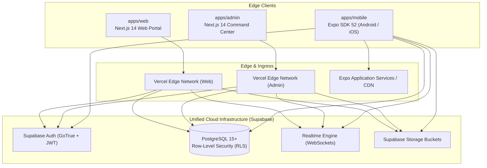

# NEXORA — Enterprise Production Deployment Runbook

> **Platform Version:** 1.0.0  
> **Architecture:** Turborepo + pnpm Workspaces Monorepo  
> **Target Environments:** Vercel (Web & Super Admin), Expo EAS (Universal Mobile - Android/iOS), Supabase Managed Cloud (PostgreSQL + Realtime + Storage + Auth)

---

## Table of Contents
1. [Architecture Overview & Topology](#1-architecture-overview--topology)
2. [Environment Variables Matrix](#2-environment-variables-matrix)
3. [Supabase Backend Cloud Provisioning](#3-supabase-backend-cloud-provisioning)
4. [Web Application Deployment (Vercel)](#4-web-application-deployment-vercel)
5. [Super Admin Command Center Deployment (Vercel)](#5-super-admin-command-center-deployment-vercel)
6. [Mobile App Deployment (Expo EAS — Android & iOS)](#6-mobile-app-deployment-expo-eas--android--ios)
7. [Post-Deployment Health Verification](#7-post-deployment-health-verification)
8. [Rollback & Disaster Recovery Procedures](#8-rollback--disaster-recovery-procedures)

---

## 1. Architecture Overview & Topology



---

## 2. Environment Variables Matrix

All applications share a single source of truth for Supabase cloud credentials while keeping environment-specific variables decoupled.

| Variable Name | Required By | Scope | Description |
|---|---|---|---|
| `NEXT_PUBLIC_SUPABASE_URL` | `apps/web`, `apps/admin` | Public / Client | Cloud Supabase project endpoint (e.g. `https://tspgkssgropugsobofey.supabase.co`) |
| `NEXT_PUBLIC_SUPABASE_PUBLISHABLE_KEY` | `apps/web`, `apps/admin` | Public / Client | Supabase Anonymous Publishable API key |
| `EXPO_PUBLIC_SUPABASE_URL` | `apps/mobile` | Public / Client | Supabase URL injected at build-time by Expo CLI |
| `EXPO_PUBLIC_SUPABASE_ANON_KEY` | `apps/mobile` | Public / Client | Supabase Anon Key for mobile network queries |
| `SUPABASE_SERVICE_ROLE_KEY` | Server Actions / Edge Functions | Secret / Server Only | High-privilege key for admin background jobs (NEVER exposed to frontend) |

---

## 3. Supabase Backend Cloud Provisioning

### 3.1 Initial Database Setup
1. Log in to [Supabase Dashboard](https://supabase.com/dashboard) and navigate to your project.
2. Open the **SQL Editor**.
3. Execute the consolidated schema migration located in `supabase/migrations/20261112000000_init_schema.sql`.
4. Ensure the following PostgreSQL extensions are enabled:
   ```sql
   CREATE EXTENSION IF NOT EXISTS "uuid-ossp";
   CREATE EXTENSION IF NOT EXISTS "pgcrypto";
   ```

### 3.2 Realtime Publication Configuration
Enable PostgreSQL Realtime change broadcasts for the core reactive tables:
```sql
ALTER PUBLICATION supabase_realtime ADD TABLE 
  public.community_posts,
  public.post_comments,
  public.post_likes,
  public.service_requests,
  public.feature_flags,
  public.maintenance_settings,
  public.user_notifications;
```

### 3.3 Storage Buckets Creation
In the **Storage** section of the Supabase Dashboard, create the following public/private buckets:
- `avatars` (Public): For user profile pictures.
- `service-media` (Public): For service catalog showcase imagery and portfolio items.
- `attachments` (Private): For customer service request files and receipts.
- `cms-media` (Public): For CMS articles and platform banners.

Set appropriate RLS storage policies allowing authenticated uploads and public reads for public buckets.

---

## 4. Web Application Deployment (Vercel)

`apps/web` is optimized for high-traffic SSR and static generation using Next.js 14 App Router.

### 4.1 Vercel Project Configuration
1. Connect your Git repository in the [Vercel Dashboard](https://vercel.com).
2. Configure project settings:
   - **Project Name:** `nexora-web`
   - **Framework Preset:** `Next.js`
   - **Root Directory:** `apps/web`
   - **Build Command:** `pnpm run build` (Turborepo automatically compiles shared packages)
   - **Output Directory:** `.next`
   - **Install Command:** `pnpm install`

### 4.2 Environment Variables in Vercel
Add the following in **Settings > Environment Variables**:
```env
NEXT_PUBLIC_SUPABASE_URL=https://tspgkssgropugsobofey.supabase.co
NEXT_PUBLIC_SUPABASE_PUBLISHABLE_KEY=sb_publishable_JpYlamzeebwTiEQS23qGVg_49BVOPDA
```

### 4.3 Custom Domain & Production Aliasing
- Add your production domain (e.g., `nexora.io` or `app.nexora.io`).
- Ensure DNS records (`A` record pointing to `76.76.21.21` or `CNAME` pointing to `cname.vercel-dns.com`) are propagated.
- Vercel automatically manages Let's Encrypt SSL certificates.

---

## 5. Super Admin Command Center Deployment (Vercel)

`apps/admin` is the high-security Super Admin Command Center featuring 30 management modules.

### 5.1 Vercel Project Configuration
1. In Vercel, import the same repository as a second project:
   - **Project Name:** `nexora-admin`
   - **Framework Preset:** `Next.js`
   - **Root Directory:** `apps/admin`
   - **Build Command:** `pnpm run build`
   - **Output Directory:** `.next`
   - **Install Command:** `pnpm install`

### 5.2 Environment Variables
```env
NEXT_PUBLIC_SUPABASE_URL=https://tspgkssgropugsobofey.supabase.co
NEXT_PUBLIC_SUPABASE_PUBLISHABLE_KEY=sb_publishable_JpYlamzeebwTiEQS23qGVg_49BVOPDA
```

### 5.3 Domain & Security Configuration
- Assign a dedicated subdomain: `admin.nexora.io` or `console.nexora.io`.
- (Recommended) Enable Vercel Deployment Protection or IP Allowlisting in production so that only authorized corporate CIDRs can access the admin domain.

---

## 6. Mobile App Deployment (Expo EAS — Android & iOS)

`apps/mobile` is built using Expo SDK 52 with cross-platform React Native code.

### 6.1 Prerequisites & Tooling
Install the Expo Application Services (EAS) CLI globally:
```bash
npm install -g eas-cli
eas login
```

Ensure `apps/mobile/eas.json` is configured with `development`, `preview`, and `production` build profiles:
```json
{
  "cli": {
    "version": ">= 12.0.0"
  },
  "build": {
    "development": {
      "developmentClient": true,
      "distribution": "internal"
    },
    "preview": {
      "distribution": "internal",
      "android": {
        "buildType": "apk"
      }
    },
    "production": {
      "android": {
        "buildType": "app-bundle"
      },
      "ios": {
        "simulator": false
      }
    }
  }
}
```

### 6.2 Android Production Build (Google Play Store)
1. Generate standalone APK for internal testing:
   ```bash
   cd apps/mobile
   eas build --platform android --profile preview
   ```
2. Generate production Android App Bundle (AAB):
   ```bash
   eas build --platform android --profile production
   ```
3. Submit bundle directly to Google Play Developer Console:
   ```bash
   eas submit --platform android
   ```
   *(Or download the `.aab` file from Expo dashboard and upload manually to Play Console under Internal Testing / Production Track).*

### 6.3 iOS Production Build (Apple App Store)
1. Ensure your Apple Developer Program membership is active.
2. Generate iOS production IPA:
   ```bash
   cd apps/mobile
   eas build --platform ios --profile production
   ```
3. Submit build to TestFlight:
   ```bash
   eas submit --platform ios
   ```

### 6.4 Over-The-Air (OTA) Updates
For minor JavaScript, styling, or copywriting fixes without re-submitting to app stores:
```bash
cd apps/mobile
eas update --branch production --message "Hotfix: Update theme colors and copy"
```

---

## 7. Post-Deployment Health Verification

After deploying, run through the following operational smoke test checklist:

- [ ] **Web Portal**: Load `https://your-web-domain.com`. Verify landing page hero animations, features cards, and footer links.
- [ ] **AI Assistant**: Click "Ask NEXORA AI" widget. Verify quick suggestions respond promptly.
- [ ] **Authentication Flow**: Sign up a test user, verify OTP/password login, and inspect session state.
- [ ] **Services Commissioning**: Navigate to `/services`, open modal, commission a test request, verify it appears under `/dashboard`.
- [ ] **Community Feed**: Post a test topic at `/community`, like the post, and verify real-time counter increment.
- [ ] **Admin Command Center**: Log in as a `super_admin`. Verify all 30 operational suites render without permission errors.
- [ ] **Remote Maintenance Toggle**: In Admin, toggle maintenance mode. Verify web and mobile clients receive WebSocket update and display the Maintenance Gate blocker.
- [ ] **Mobile App**: Launch app on physical Android/iOS device. Verify authentication, service booking, and offline caching resilience.

---

## 8. Rollback & Disaster Recovery Procedures

### 8.1 Web & Admin Rollback (Vercel)
1. Go to **Deployments** in the Vercel dashboard.
2. Select the previous stable deployment.
3. Click **Instant Rollback**. Traffic switches to the previous deployment within 2 seconds.

### 8.2 Database State Rollback
1. Supabase maintains Point-in-Time Recovery (PITR) backups on production tiers.
2. To revert destructive changes, navigate to **Database > Backups** in Supabase and restore from the desired snapshot timestamp.

### 8.3 Mobile App Emergency Mitigation
- If a mobile release contains a critical bug, do NOT wait for store review:
  1. Open Super Admin Command Center (`apps/admin`).
  2. Navigate to **App Versions & Updates**.
  3. Set `force_update = true` and advance `minimum_supported_version` to enforce immediate upgrade or fallback.
  4. Or deploy a zero-downtime OTA fix using `eas update`.
