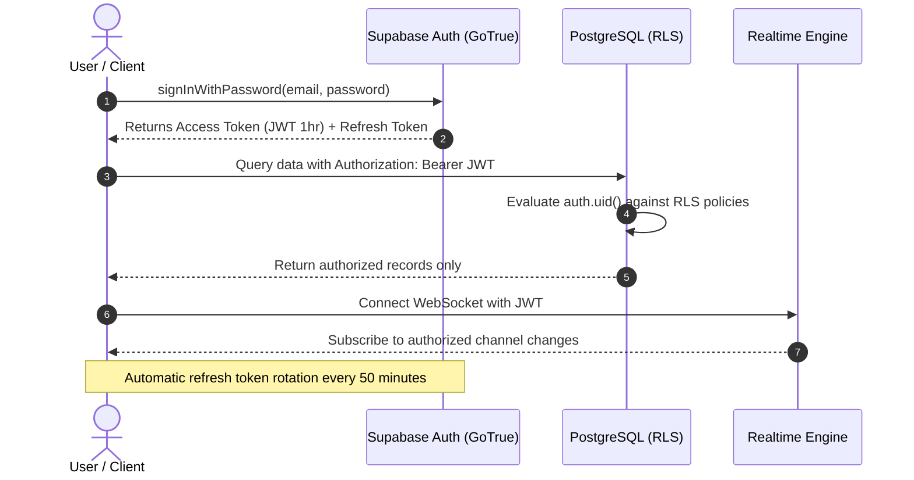

# NEXORA — Enterprise Security, Compliance & RBAC Specification

> **Classification:** Production Enterprise Standard  
> **Security Philosophy:** Defense-in-Depth, Zero-Trust Architecture, Least-Privilege Authorization

---

## Table of Contents
1. [Zero-Trust Security Principles](#1-zero-trust-security-principles)
2. [8-Tier RBAC Permission Hierarchy](#2-8-tier-rbac-permission-hierarchy)
3. [Row-Level Security (RLS) Policies Breakdown](#3-row-level-security-rls-policies-breakdown)
4. [Authentication & Session Lifecycle](#4-authentication--session-lifecycle)
5. [Dynamic Gates & Remote Kill-Switches](#5-dynamic-gates--remote-kill-switches)
6. [Audit Logging & Compliance Specifications](#6-audit-logging--compliance-specifications)

---

## 1. Zero-Trust Security Principles

NEXORA operates on strict Zero-Trust foundations:
- **Never Trust Client-Side Claims**: UI hiding is solely a UX convenience. All database queries, mutation endpoints, and RPC procedures enforce database-level authorization via PostgreSQL Row-Level Security (RLS) and stored functions.
- **Service Role Secret Isolation**: The Supabase Service Role key is strictly forbidden in client repositories, web bundles, or mobile assets. Frontend apps interact exclusively through the publishable anonymous key and authenticated user JWTs (`auth.uid()`).
- **Least-Privilege Role Clearance**: Users and administrators receive only the granular permissions required for their assigned roles.
- **Tamper-Evident Auditing**: Administrative actions automatically record the actor's identity, timestamp, IP address, and payload delta.

---

## 2. 8-Tier RBAC Permission Hierarchy

NEXORA provides an 8-tier Role-Based Access Control matrix engineered in `@nexora/business-logic/src/permissions.ts`.

### 2.1 Role Definitions & Clearances

| Role Identifier | Clearance Level | Operational Scope | Target Persona |
|---|---|---|---|
| `super_admin` | Level 8 (Maximum) | Unrestricted global override; access to all features, finances, security keys, and user lifecycles. | Platform Founder, CTO |
| `system_admin` | Level 7 | Infrastructure configuration, feature flags, maintenance mode, user lifecycle management (excluding super admins). | Lead DevOps, Infrastructure Engineer |
| `manager` | Level 6 | Service catalog management, order fulfillment, team coordination, content publishing. | Operations Director, Product Lead |
| `finance_admin` | Level 5 | Payment processing, invoice generation, customer refunds, financial audit logs. | Finance Officer, Accounting Lead |
| `moderator` | Level 4 | Community discussions moderation, comment filtering, post takedowns, spam prevention. | Community Manager, Content Moderator |
| `support_agent` | Level 3 | Read-only user lookup, ticket investigation, service status queries. | Customer Support Specialist |
| `analyst` | Level 2 | Read-only analytics dashboards, metrics reporting, performance logs. | Data Analyst, Business Intelligence |
| `user` | Level 1 (Default) | Standard customer access: browsing services, commissioning work, participating in community threads. | Customer, Registered User |

### 2.2 Granular Permission Codes Reference Matrix

Below is the definitive mapping of the 22 system permission codes across roles:

| Permission Code | `super_admin` | `system_admin` | `manager` | `finance_admin` | `moderator` | `support_agent` | `analyst` | `user` |
|---|:---:|:---:|:---:|:---:|:---:|:---:|:---:|:---:|
| `user.read` | ✅ | ✅ | ✅ | ❌ | ✅ | ✅ | ❌ | ❌ |
| `user.write` | ✅ | ✅ | ❌ | ❌ | ❌ | ❌ | ❌ | ❌ |
| `user.update` | ✅ | ✅ | ❌ | ❌ | ❌ | ❌ | ❌ | ❌ |
| `user.suspend` | ✅ | ✅ | ❌ | ❌ | ❌ | ❌ | ❌ | ❌ |
| `user.delete` | ✅ | ❌ | ❌ | ❌ | ❌ | ❌ | ❌ | ❌ |
| `admin.manage` | ✅ | ❌ | ❌ | ❌ | ❌ | ❌ | ❌ | ❌ |
| `app.config.read` | ✅ | ✅ | ❌ | ❌ | ❌ | ❌ | ❌ | ❌ |
| `app.config.update` | ✅ | ✅ | ❌ | ❌ | ❌ | ❌ | ❌ | ❌ |
| `feature.read` | ✅ | ✅ | ❌ | ❌ | ❌ | ❌ | ❌ | ❌ |
| `feature.manage` | ✅ | ✅ | ❌ | ❌ | ❌ | ❌ | ❌ | ❌ |
| `payment.read` | ✅ | ❌ | ❌ | ✅ | ❌ | ❌ | ❌ | ❌ |
| `payment.refund` | ✅ | ❌ | ❌ | ✅ | ❌ | ❌ | ❌ | ❌ |
| `payment.manage` | ✅ | ❌ | ❌ | ✅ | ❌ | ❌ | ❌ | ❌ |
| `content.read` | ✅ | ✅ | ✅ | ❌ | ✅ | ✅ | ✅ | ✅ |
| `content.create` | ✅ | ❌ | ✅ | ❌ | ❌ | ❌ | ❌ | ❌ |
| `content.publish` | ✅ | ✅ | ✅ | ❌ | ❌ | ❌ | ❌ | ❌ |
| `content.delete` | ✅ | ❌ | ❌ | ❌ | ❌ | ❌ | ❌ | ❌ |
| `community.moderate`| ✅ | ✅ | ✅ | ❌ | ✅ | ❌ | ❌ | ❌ |
| `audit.read` | ✅ | ✅ | ❌ | ✅ | ❌ | ❌ | ✅ | ❌ |
| `service.manage` | ✅ | ❌ | ✅ | ❌ | ❌ | ❌ | ❌ | ❌ |
| `ai.manage` | ✅ | ❌ | ❌ | ❌ | ❌ | ❌ | ❌ | ❌ |
| `notification.send`| ✅ | ✅ | ✅ | ❌ | ❌ | ❌ | ❌ | ❌ |

---

## 3. Row-Level Security (RLS) Policies Breakdown

All tables in the NEXORA schema enforce `ENABLE ROW LEVEL SECURITY`. Every transaction evaluates PostgreSQL policies matching `auth.uid()`.

### 3.1 Core Table RLS Policies

```sql
-- User Profiles Table
ALTER TABLE public.user_profiles ENABLE ROW LEVEL SECURITY;

CREATE POLICY "Public profiles are readable by authenticated users"
  ON public.user_profiles FOR SELECT
  TO authenticated
  USING (true);

CREATE POLICY "Users can edit own profile only"
  ON public.user_profiles FOR UPDATE
  TO authenticated
  USING (auth.uid() = id)
  WITH CHECK (auth.uid() = id);

-- Service Requests Table
ALTER TABLE public.service_requests ENABLE ROW LEVEL SECURITY;

CREATE POLICY "Users can read own service requests"
  ON public.service_requests FOR SELECT
  TO authenticated
  USING (auth.uid() = user_id OR public.has_role(auth.uid(), 'super_admin') OR public.has_role(auth.uid(), 'manager'));

CREATE POLICY "Authenticated users can submit service requests"
  ON public.service_requests FOR INSERT
  TO authenticated
  WITH CHECK (auth.uid() = user_id);

CREATE POLICY "Staff can update service request statuses"
  ON public.service_requests FOR UPDATE
  TO authenticated
  USING (public.has_role(auth.uid(), 'super_admin') OR public.has_role(auth.uid(), 'manager'));

-- Community Posts & Comments Table
ALTER TABLE public.community_posts ENABLE ROW LEVEL SECURITY;

CREATE POLICY "Community posts are readable by everyone"
  ON public.community_posts FOR SELECT
  TO public
  USING (status = 'published');

CREATE POLICY "Authenticated users can publish posts"
  ON public.community_posts FOR INSERT
  TO authenticated
  WITH CHECK (auth.uid() = author_id);

CREATE POLICY "Authors or moderators can update posts"
  ON public.community_posts FOR UPDATE
  TO authenticated
  USING (auth.uid() = author_id OR public.has_permission(auth.uid(), 'community.moderate'));

-- Central Remote Config & Feature Flags
ALTER TABLE public.feature_flags ENABLE ROW LEVEL SECURITY;

CREATE POLICY "Everyone can read active feature flags"
  ON public.feature_flags FOR SELECT
  TO public
  USING (true);

CREATE POLICY "Admins can manage feature flags"
  ON public.feature_flags FOR ALL
  TO authenticated
  USING (public.has_permission(auth.uid(), 'feature.manage'));
```

---

## 4. Authentication & Session Lifecycle



### 4.1 Token Specifications
- **JWT Expiration:** 3600 seconds (1 hour).
- **Refresh Token Rotation:** Enabled. A new refresh token is issued each time the session refreshes, invalidating previous tokens to mitigate token-theft replays.
- **PKCE (Proof Key for Code Exchange):** Enforced across both Next.js App Router and Expo mobile authentication flows.

---

## 5. Dynamic Gates & Remote Kill-Switches

### 5.1 Maintenance Gate
- Controlled via `maintenance_settings` table.
- When `is_enabled = true`, all web and mobile clients receive an instant Realtime WebSocket push that mounts the `MaintenanceGate` component.
- **Emergency Bypass:** Users possessing `super_admin` or roles defined in `allowed_roles` bypass the block via secret clearance check.

### 5.2 Version Policy Gate
- Evaluated via `compareSemver(currentVersion, policy.minimum_supported_version)`.
- If client version < `minimum_supported_version`, the app hard-locks with an un-dismissible dialog directing users to the respective App Store or Web URL.

---

## 6. Audit Logging & Compliance Specifications

All high-impact administrative actions generate an immutable record in `audit_logs`:

```typescript
export interface AuditLog {
  id: string;
  actor_id: string;
  action: 'UPDATE_CONFIG' | 'UPDATE_FLAG' | 'SUSPEND_USER' | 'REFUND_ORDER' | 'TOGGLE_MAINTENANCE';
  target_resource: string;
  ip_address?: string;
  user_agent?: string;
  previous_state: Record<string, unknown>;
  new_state: Record<string, unknown>;
  created_at: string;
}
```

Audit records are append-only. No role (including `super_admin`) has `DELETE` permissions on `audit_logs`, providing forensic non-repudiation for enterprise compliance (SOC 2 & ISO 27001 readiness).
